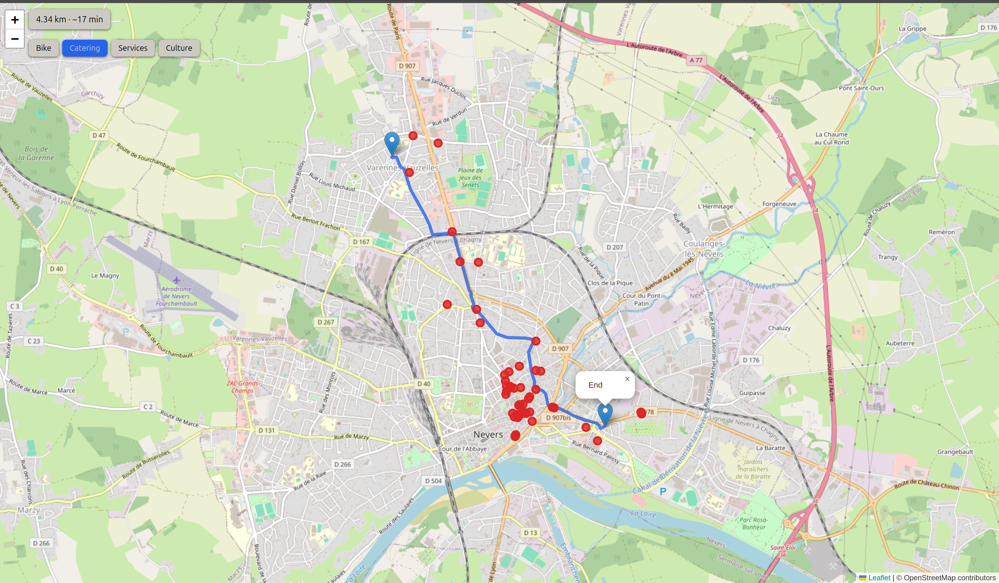

# Small Routing Engine

A self-hosted bicycle routing engine for Nevers (France), built on
PostGIS and pgRouting, with a layered Python API serving GeoJSON and a
minimal Leaflet frontend.

The project explores a middle path between black-box routing APIs and
planet-scale open-source engines: a routing stack small enough for a
municipality, a small consultancy or an NGO to run, adapt and feed with
its own local data.

**Status:** V1 in progress. The core engine, API, tests and CI are
complete; slope-aware costs from the IGN elevation model are being
integrated (raster loaded, cost integration under way).



---

## What this project demonstrates

- **Geospatial ETL**: OSM extraction (osmium, Overpass), cleaning in QGIS,
  automated import into PostGIS (`ogr2ogr`); IGN DEM mosaicked, resampled
  and tiled into PostGIS raster (GDAL, `raster2pgsql`).
- **Database as source of truth**: the whole routing chain (snapping,
  `pgr_dijkstra` on a directed graph, metrics, GeoJSON export) is PL/pgSQL.
  Python orchestrates, it does not re-implement.
- **Build-time validation**: SQL guardrails check the graph before and
  after construction; the API refuses to start on an uncertified graph.
- **Sub-second queries**: on an 86,867-edge graph, ~68 ms for a 2 km urban
  route, ~258 ms for a 33 km diametral one (dev laptop, warm cache).
- **Layered API**: Blueprint / DTO / Service / Repository, PostgreSQL
  error tags mapped to HTTP status codes (400, 404, 422, 503).
- **Tested and reproducible**: pytest integration suite running against
  ephemeral Docker stacks (Testcontainers), SQL guardrail test suites,
  curl end-to-end suite, GitHub Actions CI.

## Stack

| Layer    | Tools                                                        |
|----------|--------------------------------------------------------------|
| Data     | PostgreSQL 16, PostGIS 3.4, pgRouting 3.8                    |
| Pipeline | osmium-tool, ogr2ogr, GDAL, raster2pgsql, QGIS               |
| API      | Python 3.11, Flask, psycopg2                                 |
| Frontend | Leaflet (served by Flask)                                    |
| Tests/CI | pytest, Testcontainers, curl, GitHub Actions                 |
| Infra    | Docker Compose, GNU Make                                     |
| SRID     | EPSG:2154 (storage, metric), EPSG:4326 (API, GeoJSON)        |

---

## Run it

**Prerequisites:** Docker with Compose v2 (`docker compose`). GNU Make is
optional: every target has a raw Docker equivalent below. The cleaned
datasets are committed in the repository.

```bash
git clone https://github.com/Marie-T-code/small_routing_engine
cd small_routing_engine
cp .env.example .env        # working dev defaults, runs as-is
make build pipeline up      # first run
```

The API and the frontend are then available at `http://localhost:5000`.

| make                     | docker compose (Windows / no make)                           |
|--------------------------|--------------------------------------------------------------|
| `make build`             | `docker compose --profile "*" build`                         |
| `make pipeline`          | `docker compose --profile pipeline run --rm loader`<br>`docker compose --profile pipeline run --rm --no-deps builder` |
| `make up`                | `docker compose up`                                          |
| `make down`              | `docker compose --profile "*" down`                          |
| `make psql`              | `docker compose exec db psql`                                |
| `make test-api`          | requires bash (Linux, macOS, WSL)                            |
| `make export-sql FILE=…` | Linux only (host UID/GID mapping, see `docker.md`)           |
| `make pytest`            | `pytest tests/pytest`  need venv + requirements_dev.txt      |

> `make pipeline` runs the loader, then the builder **only if the loader
> succeeded**. Without make, run the two commands in order and check that
> the first one exits without error before launching the second.

Run `make` alone to list all targets.

### Try a route

```bash
curl "http://localhost:5000/api/route?lat_start=46.9862&lon_start=3.1887&lat_end=46.9877&lon_end=3.1656&speed_kmh=15"
```

| Endpoint            | Returns                                                  |
|---------------------|----------------------------------------------------------|
| `/api/route`        | GeoJSON route with distance and ETA                      |
| `/api/pois_search`  | Points of interest of one category along a route         |
| `/api/coverage`     | Polygon of the routable area                             |
| `/api/test_db`      | Health check                                             |

Error codes and their HTTP mapping: [`error_codes_sre.md`](./documentation/error_codes_sre.md).

---

## Documentation

> The detailed docs are being updated after the October–November
> refactor. Each file states its last review date at the top.

| Start here | |
|---|---|
| [`pipeline.md`](./documentation/pipeline.md) | End-to-end data flow, from OSM to the API |
| [`architecture.md`](./documentation/architecture.md) | SQL engine layout, build masters, Python layers, tests |

| Reference | |
|---|---|
| [`engine_functions.md`](./documentation/engine_functions.md) | PL/pgSQL function catalogue: the core of the engine |
| [`data_model.md`](./documentation/data_model.md) | Tables, views, indexes, SRID strategy |
| [`error_codes_sre.md`](./documentation/error_codes_sre.md) | Structured error tags and HTTP mapping |
| [`docker.md`](./documentation/docker.md) | Services, profiles, troubleshooting |

| Design notes | |
|---|---|
| [`data_quality.md`](./documentation/data_quality.md) | Data quality choices and their limits |
| [`graph_build.md`](./documentation/graph_build.md) | How `pgr_createTopology` builds a graph, and its idempotence trap |
| [`raster_notes.md`](./documentation/raster_notes.md) | Building a single DEM from two IGN sources |
| [`raster_tiling_benchmark.md`](./documentation/raster_tiling_benchmark.md) | Why the DEM is tiled 64×64 |
| [`the_road_so_far.md`](./documentation/the_road_so_far.md) | Project log |

---

## Roadmap

- **Now (V1):** slope-aware costs (flat / slope profiles), raster
  guardrails and tests, documentation review.
- **Next (V2, separate fork):** FastAPI, Pydantic v2, connection pooling,
  MapLibre, deployment with observability and security.
- **Later:** multi-criteria costs, user feedback on routes, daily data
  refresh. Known limitations are listed in
  [`data_quality.md`](./documentation/data_quality.md).

---

## Data and licences

- **Code:** MIT, see [LICENSE](./LICENSE).
- **Road network and points of interest:** © [OpenStreetMap](https://www.openstreetmap.org/copyright)
  contributors, available under the
  [Open Database License (ODbL)](https://opendatacommons.org/licenses/odbl/).
  The cleaned GeoPackages in `DATA/clean/` are derived from OSM and remain
  under ODbL.
- **Elevation:** IGN, RGE ALTI® — Nièvre (58), 5 m, version dated 2023-08-01;
  Cher (18), 1 m resampled to 5 m, version dated 2023-01-03.
  Accessed 2026-07-07 via cartes.gouv.fr. Licence Ouverte Etalab 2.0.
  Mosaicked and clipped for this project.


## References

- **scientific sources** can be found in [biblio](./biblio)
  on bike uses: 
  - Gras Gentiletti, M., Cahour, B., & Safin, S. (2025). Abandoning the car to embrace the bicycle in urban France: A model of modal shift for daily commuting routines. *Sustainability*, *17*(2), 448. [https://doi.org/10.3390/su17020448](https://doi.org/10.3390/su17020448)
